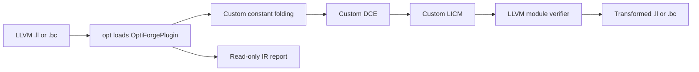

# OptiForge

[](https://github.com/Pranjalgit1/OptiForge-LLVM-Based-Compiler-Optimization-Framework/actions/workflows/ci.yml)

## Overview

OptiForge is an educational LLVM compiler optimization framework written in
C++17. It loads into `opt`, analyzes LLVM IR, runs three custom transformations,
and verifies the output. A Python benchmark runner checks matched executables
and reports actual measurements with raw samples and toolchain provenance.

**Version 0.8.0: all eight planned phases are implemented.** The supported
transformations are deliberately restricted; this is a compiler engineering
learning project, not a replacement for LLVM's production optimizers.

## Motivation

An optimization must preserve program semantics before its speed matters.
This project makes that work visible: integer width and overflow promises,
poison and undef, SSA use chains, side effects, loop preheaders, dominance,
speculation safety, analysis invalidation, and fair performance comparisons.
The implementations own their transformation algorithms rather than calling
LLVM's existing constant folding, DCE, or LICM passes.

## Tech Stack

| Component | Supported configuration |
| --- | --- |
| Language | C++17 |
| Infrastructure | LLVM 21, New Pass Manager; locally verified with 21.1.8 |
| Compiler | Clang from the same LLVM installation and upstream version |
| Build | CMake 3.20+ and Ninja |
| Tests | LLVM lit, FileCheck, verifier, Python oracle, C++ execution checks |
| Benchmarking | Python 3.8+ standard library; C++ steady-clock timing |
| Platform | Linux x86_64; locally tested on Ubuntu 26.04 under Windows WSL2 |

Native Windows `.dll` plugin builds are outside the tested configuration. The
Windows checkout can remain on the mounted drive while every LLVM tool runs
inside Ubuntu. Do not mix Linux plugins with Windows `opt.exe`.

## Architecture



`tools/OptiForgePlugin.cpp` registers independent function passes and the named
`optiforge` module pipeline. The function analysis manager supplies LoopInfo,
dominance, and our cached statistics. Each transformation invalidates analyses
conservatively when it changes IR.

```text
include/       Pass declarations and analysis result
lib/           Custom analysis and transformation implementations
tools/         Plugin entry point and pipeline registration
tests/         lit/FileCheck, semantic oracle, and executable checks
examples/      Small C++ arithmetic and loop examples
benchmarks/    Four workloads, driver, and Python runner
scripts/       Environment prerequisite checker
results/phase7/ Committed measurements and provenance; binaries excluded
docs/          Architecture, safety, methodology, and interview notes
```

See [architecture](docs/architecture.md) and [optimization contracts](docs/optimizations.md).

## Installation

On Windows, open the installed Ubuntu distribution:

```powershell
wsl -d Ubuntu
```

Inside Ubuntu 26.04:

```bash
sudo apt-get update
sudo apt-get install -y clang-21 llvm-21-dev llvm-21-tools cmake ninja-build python3 git
git clone https://github.com/Pranjalgit1/OptiForge-LLVM-Based-Compiler-Optimization-Framework.git
cd OptiForge-LLVM-Based-Compiler-Optimization-Framework
python3 scripts/setup_check.py

cmake -S . -B build -G Ninja \
  -DCMAKE_BUILD_TYPE=Release \
  -DCMAKE_C_COMPILER=/usr/lib/llvm-21/bin/clang \
  -DCMAKE_CXX_COMPILER=/usr/lib/llvm-21/bin/clang++ \
  -DLLVM_DIR=/usr/lib/llvm-21/lib/cmake/llvm
cmake --build build -j2
```

For the existing development checkout, use
`cd /mnt/c/Users/pranj/Desktop/projects/compiler` instead of cloning again.
`llvm-21-dev` supplies headers/libraries; Clang alone is insufficient. The setup
checker checks matching tool versions; successful plugin loading is the runtime
ABI check. Rebuild after updating the LLVM packages. See
[environment details](docs/environment.md) and [troubleshooting](docs/phase1.md).
Other distributions may need `-DOPTIFORGE_LIT=/path/to/lit.py` at configuration.

## Usage

Run the complete pipeline and write verified textual IR:

```bash
/usr/lib/llvm-21/bin/opt \
  -load-pass-plugin=./build/lib/OptiForgePlugin.so \
  -passes=optiforge -verify-each -S \
  tests/integration/pipeline.ll -o build/optimized.ll
```

For bitcode, omit `-S`; `opt` accepts either `.ll` or `.bc` input:

```bash
/usr/lib/llvm-21/bin/opt tests/integration/pipeline.ll -o build/input.bc
/usr/lib/llvm-21/bin/opt \
  -load-pass-plugin=./build/lib/OptiForgePlugin.so \
  -passes=optiforge -verify-each build/input.bc -o build/output.bc
```

Each pass is independently selectable through `-passes`:

| Name | Behavior |
| --- | --- |
| `optiforge-hello` | Minimal diagnostic plugin smoke test |
| `optiforge-analyze` | Function/block/instruction/loop counts and opportunity hints |
| `optiforge-constant-folding` | Supported constant integer operations |
| `optiforge-dce` | Supported trivially dead SSA computations |
| `optiforge-licm` | Supported safe loop-invariant arithmetic |
| `optiforge` | Folding, DCE, LICM, then module verification |

The explicit equivalent is
`-passes='function(optiforge-constant-folding,optiforge-dce,optiforge-licm),verify'`.
The named pipeline makes one ordered sweep, not an arbitrary fixed point.

Compile and analyze a C++ example:

```bash
/usr/lib/llvm-21/bin/clang++ -std=c++17 -O0 -S -emit-llvm \
  examples/loops.cpp -o build/loops.ll
/usr/lib/llvm-21/bin/opt \
  -load-pass-plugin=./build/lib/OptiForgePlugin.so \
  -passes=optiforge-analyze -verify-each -disable-output build/loops.ll
```

`sum_array` reports one loop; `nested_sum` reports two. Diagnostics go to stderr.
Clang `-O0` typically adds `optnone` and stack accesses. Diagnostic passes still
run, while transformations respect the optimization opt-out. Hand-written
fixtures expose opportunities that the frontend may already fold or delete.

## Optimization Passes

| Pass | Initial supported scope | Deliberate exclusions |
| --- | --- | --- |
| Constant folding | Scalar literal-integer `add/sub/mul/and/or/xor`; exact-width APInt; proven `nsw`/`nuw` | Poison/undef operands, wrap-flag violations, `or disjoint`, division, shifts, FP, vectors |
| DCE | Restricted integer operations and pure SSA classes; unused results plus LLVM safety predicate | Memory, calls, allocations, terminators, dead stores/blocks, dead SSA cycles |
| LICM | Used unflagged scalar `add/sub/mul/and/or/xor`; preheader, operand dominance, speculation safety | Memory, calls, flagged arithmetic, division, shifts, FP, vectors, absent preheaders |

Example before folding and DCE:

```llvm
define i32 @example(i32 %x) {
  %result = add i32 10, 20
  %dead = mul i32 %x, 6
  %dead_user = add i32 %dead, 1
  ret i32 %result
}
```

After:

```llvm
define i32 @example(i32 %x) {
  ret i32 30
}
```

LICM moves invariant arithmetic into an existing preheader; changing its
execution frequency requires speculation and dominance checks, even for
zero-iteration loops. [Optimization documentation](docs/optimizations.md)
includes LICM placement examples and the semantic boundaries of all three passes.

## Testing

```bash
cmake --build build --target check-optiforge
```

Alternatively, after building, use `ctest --test-dir build --output-on-failure`.
The suite currently contains **22 lit test files**, including:

- Exact IR output, unsupported-case preservation, `.ll`/`.bc`, `optnone`, and verifier checks.
- Arithmetic and natural-loop reports, nested/conditional/zero-iteration loops, and missing preheaders.
- An exhaustive Python oracle for 3,840 four-bit arithmetic/flag cases.
- Compiled baseline/transformed checks against unsigned C++ references, including observable stores.
- Named/explicit pipeline equivalence and analysis invalidation.
- A fast benchmark-runner regression checking statistics, reports, compilation, and correctness.

The [CI workflow](.github/workflows/ci.yml) builds Release and Debug configurations
with matching LLVM 21 packages on Ubuntu 26.04. CI runs correctness tests and the
small runner regression; it does not assert speedup or run the full benchmark.

## Performance Results

```bash
python3 benchmarks/run_benchmarks.py --output results/local-run
```

Use a new output directory. Defaults are nine samples per variant, two warmups,
fixed-seed pair ordering, and shared calibration targeting 50 ms per kernel call.
The [methodology](docs/benchmarking.md) explains matched settings and measurement
limitations. The [committed report](results/phase7/report.md),
[raw samples](results/phase7/samples.csv), [summary](results/phase7/summary.csv),
and [environment/commands](results/phase7/metadata.json) describe actual results
from an i5-13500HX under Ubuntu WSL2 with LLVM 21.1.8 on 2026-10-14.

Controlled mode uses identical prepared IR and `-O0` backend settings; only the
custom pipeline differs. The recorded median kernel times were:

| Workload | Baseline ms | Custom ms | Runtime reduction | Baseline/custom MAD ms |
| --- | --- | --- | --- | --- |
| Array processing | 85.341 | 72.560 | 14.98% | 4.023 / 1.689 |
| Numerical recurrence | 76.928 | 75.937 | 1.29% | 1.038 / 0.159 |
| Nested loops | 69.033 | 64.139 | 7.09% | 1.033 / 1.601 |
| Artificial repeated arithmetic | 114.490 | 93.571 | 18.27% | 0.814 / 0.610 |

These are local observations, without a significance claim. The small numerical
change is comparable to observed variation. Different rows may use different
calibrated repetition counts; compare variants within a row.

Standard mode gives both variants the same `default<O2>` pipeline and `-O2`
backend compilation. **All four standard-mode kernel object pairs were
byte-identical** ([SHA-256 audit](results/phase7/artifact_hashes.json)); their small
timing differences are measurement noise. The controlled results do not show
that these passes outperform production LLVM optimization.

Static IR instruction counts and object sizes are also recorded. IR counts
are not dynamic CPU instruction counts; hoisting can change execution frequency
without changing the static count.

## Limitations

The verifier establishes IR structure, not semantic equivalence. Correctness
rests on restricted transformation contracts, LLVM safety utilities, and tests;
there is no formal proof for arbitrary LLVM IR. Unsupported opportunities remain.
Analysis opportunity counts are hints, not transformation guarantees.

There is no memory optimization, loop canonicalization inside the custom
pipeline, general constant propagation, dead-cycle elimination, automatic Clang
insertion, target tuning, or profitability model. LICM's simple repeated scan can
be quadratic. The tested ABI is Linux x86_64 with matching LLVM 21 components.
WSL scheduling and host load affect timing; full methodology and environment
details accompany every retained benchmark claim.

## Future Improvements

Potential extensions include Alive2 validation, more integer operations with
explicit poison semantics, faster invariant discovery, carefully analyzed load
hoisting with MemorySSA/alias analysis, additional LLVM versions, and hardware
counter measurements. These are proposals, not implemented features.

## Documentation and Interview Preparation

- [Architecture](docs/architecture.md) and [optimization contracts](docs/optimizations.md).
- [IR/SSA walkthrough](docs/phase2.md), [folding/DCE](docs/phases3-4.md), [LICM](docs/phase5.md), and [pipeline](docs/phase6.md).
- [Benchmark methodology](docs/benchmarking.md) and [interview questions/resume bullet](docs/interview.md).
- [Release notes and validation](docs/release.md), [changelog](CHANGELOG.md), and [contributing](CONTRIBUTING.md).

Primary references: [LLVM New Pass Manager](https://llvm.org/docs/NewPassManager.html),
[LLVM language reference](https://llvm.org/docs/LangRef.html),
[LLVM loop terminology](https://llvm.org/docs/LoopTerminology.html).
